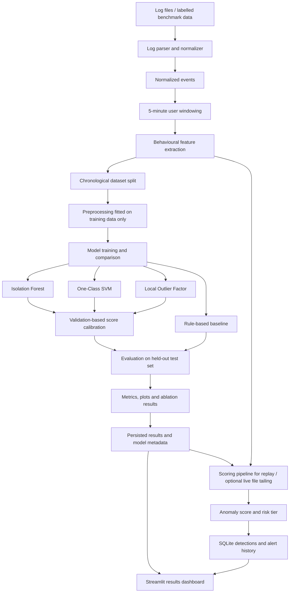

# AI-Based Log Anomaly Detection System — Final Architecture

## 1. Project objective

Build an AI/ML course project that detects unusual authentication and security-log behaviour using **unsupervised anomaly detection**. The system converts raw log events into behavioural features, scores each user's activity over a fixed time window, evaluates model performance against labelled test data, and presents findings through a dashboard.

The academic focus is on:
- Feature engineering for behavioural data.
- Comparing unsupervised anomaly-detection algorithms.
- Calibrating thresholds and measuring the precision/recall trade-off.
- Testing the contribution of feature groups through ablation experiments.
- Explaining predictions and presenting reproducible evaluation results.

This is a course-project prototype, not a production SIEM or a claim of real-world security effectiveness.

## 2. Design principles

1. **ML first:** implement and evaluate the detector before building the dashboard or notification integrations.
2. **Unsupervised training, labelled evaluation:** attack labels are not required to fit the primary model, but labels are required for meaningful evaluation metrics.
3. **Reproducible experiments:** use fixed data splits, recorded configuration, model parameters, random seeds, and saved results.
4. **No train/test leakage:** split chronologically before fitting preprocessing or calculating learned baselines.
5. **One sample definition:** one sample is one `(user, 5-minute window)` feature vector.
6. **Keep the first version small:** use replayable log files and a small set of well-defined sources before adding live ingestion or extra integrations.

## 3. High-level architecture



**Flow summary:** logs are parsed into a common event schema; events are grouped into five-minute per-user windows; each window becomes a feature vector. The training/evaluation path compares models and calibrates thresholds using validation data. The selected model can then score replayed or optionally tailed logs. Results are stored and visualized.

## 4. Scope

### In scope for the first version
- Replay from sample log files.
- Linux SSH/PAM authentication logs as the primary source.
- Optional normalized Windows authentication-event CSV input if available.
- A synthetic log generator with known labels for controlled experiments.
- Five-minute per-user windows and behavioural feature extraction.
- Isolation Forest as the primary model.
- One-Class SVM and Local Outlier Factor as comparison models.
- A simple rule-based baseline.
- Validation-based threshold selection.
- Feature-family ablation experiments.
- Metrics, plots, saved experiment metadata, and a Streamlit dashboard.
- SQLite for storing processed events, detections, and analyst annotations.

### Deferred until the core experiment works
- Live file tailing and syslog listeners.
- Drain3 template mining for unknown log formats.
- Windows/Active Directory multi-source ingestion beyond prepared normalized data.
- Email/webhook notifications.
- GeoIP enrichment.
- Kafka-style streaming, SIEM integrations, LLM triage, sequence models, and production deployment.

## 5. Data and event processing

### 5.1 Input sources
Use:
- **Synthetic logs:** generate normal activity and controlled attack scenarios (for example, repeated failed logins, distributed attempts, off-hours logins, new source IPs, and success after repeated failures). Preserve labels separately for evaluation.
- **Public data where feasible:** use a suitable labelled dataset for quantitative evaluation and unlabelled OpenSSH logs for parser testing. State dataset limitations explicitly.
- **Primary implementation source:** Linux SSH/PAM authentication logs. Add additional sources only when their fields can be mapped reliably.

### 5.2 Normalized event schema
Each parsed event should contain:

| Field | Meaning |
|---|---|
| `ts` | Timestamp normalized to UTC |
| `host` | Source host or endpoint |
| `username` | User/account associated with the event, if available |
| `src_ip` | Source IP, if available |
| `dst_ip` | Destination IP, if available |
| `event_type` | Normalized event type, such as `LOGIN_FAILED`, `LOGIN_SUCCESS`, or `ACCOUNT_LOCKOUT` |
| `status` | `SUCCESS`, `FAILURE`, or `UNKNOWN` |
| `source_type` | Originating log format |
| `native_event_id` | Original event identifier, if available |
| `raw_line` | Original line for debugging and traceability |

Malformed or unsupported lines should be counted and reported rather than silently discarded.

### 5.3 Windowing
- Sample unit: one `(username, window_start)` pair.
- Window: tumbling five-minute interval.
- Create windows only when at least one relevant event exists.
- For live/replay operation, define a configurable grace period for late events.
- Do not create train/test splits by randomly shuffling windows. Use chronological splits.
- Prevent overlapping windows from placing near-duplicate samples across splits.

## 6. Behavioural feature engineering

Start with the following 18 features, provided the input data supports them. If an optional feature cannot be computed reliably, document and remove it rather than filling it with misleading constants.

| Family | Feature | Definition |
|---|---|---|
| Failed logins | `failed_count` | Number of failed login events in the window |
| Failed logins | `failed_ratio` | Failed / (failed + successful logins); zero if there are no login events |
| Failed logins | `max_failed_burst_60s` | Highest number of failures in any 60-second sub-window |
| Failed logins | `consecutive_failed_max` | Longest sequence of failures without a success in between |
| Failed logins | `distinct_hosts_failed` | Number of hosts with at least one failure |
| Failed logins | `success_after_failed` | 1 if a success follows at least five failures in the window; otherwise 0 |
| Event frequency | `event_count` | Total events attributed to the user in the window |
| Event frequency | `event_rate_z` | Robust deviation from the user's historical event-count baseline |
| Event frequency | `distinct_event_types` | Number of distinct event types in the window |
| IP activity | `distinct_src_ips` | Number of distinct source IPs |
| IP activity | `new_ip_count` | Number of source IPs not seen in the applicable training/history baseline |
| IP activity | `max_events_per_ip` | Maximum events attributed to any one source IP |
| IP activity | `geo_country_change` | Optional indicator for a source country outside the user's baseline countries; only when reliable GeoIP data is available |
| Time patterns | `hour_sin` | Sine encoding of hour-of-day |
| Time patterns | `hour_cos` | Cosine encoding of hour-of-day |
| Time patterns | `is_off_hours` | Whether activity falls outside a defined or learned normal activity period |
| Time patterns | `is_weekend` | Whether the event occurs on a weekend |
| Time patterns | `hour_deviation` | Circular distance from the user's baseline activity hour |

This is the initial feature set, not a requirement to force every source into the same 18 columns. Feature availability and definitions must be consistent between training, validation, test, and scoring.

### Baselines and cold-start handling
- Calculate historical baselines using training-period data only; update them only under a documented policy.
- Use robust statistics such as median and median absolute deviation where appropriate.
- Track how much history is available for each user.
- For new or low-activity users, use a documented fallback (such as a global training baseline) and report their results separately.
- Do not use future events or test-period information to calculate historical features.

## 7. ML models and decision logic

### 7.1 Primary model
Use **Isolation Forest** as the primary model. It is suitable as a lightweight unsupervised baseline for tabular behavioural features.

Initial parameters may include:
- `n_estimators = 200`
- `max_samples = 256` (subject to dataset size)
- `random_state = 42`
- `n_jobs = -1`

Treat these as starting values, not guaranteed optimal settings. Record parameters and test multiple seeds for final comparisons.

### 7.2 Comparison models
- **One-Class SVM:** scale features using a preprocessing pipeline fitted on training data only.
- **Local Outlier Factor:** use novelty detection mode if scoring unseen validation/test samples; do not use training-only outlier labels as if they were directly comparable.
- **Rule-based baseline:** for example, a threshold on failed login counts. Tune its threshold on validation data, not the test set.

Fit imputation, encoding, scaling, and any learned transformation on training data only. Isolation Forest does not require feature scaling in the same way as distance/kernel-based models, but a shared reproducible pipeline can still be used if justified.

### 7.3 Scores and risk tiers
- Convert model outputs to a consistent direction so that higher values mean “more anomalous.”
- Do not assume raw scores from different algorithms share the same scale.
- Calibrate each model's threshold on the validation split and report the operating point.
- If four tiers are required, define `LOW`, `MEDIUM`, `HIGH`, and `CRITICAL` through validation-calibrated bands.
- Keep rule-based corroboration as a separate, configurable decision layer. Evaluate both the model-only result and the combined model-plus-rules result.
- Avoid claiming that a combined rule/ML alert is automatically “high confidence”; demonstrate this using evaluation results.

## 8. Experimental methodology — core AI contribution

### 8.1 Data split
Use a chronological split:
- Earliest 60%: training (prefer normal or predominantly normal windows for unsupervised fitting).
- Next 20%: validation (threshold calibration and configuration decisions).
- Latest 20%: held-out test (final reporting only).

Adjust ratios if the dataset is small, but document the decision. Keep labels out of model fitting when claiming unsupervised training. Labels may be used on validation data for supervised metric/threshold selection if explicitly documented; do not use test labels to tune the model or thresholds.

### 8.2 Model comparison
Compare Isolation Forest, One-Class SVM, Local Outlier Factor, and the rule-based baseline on the same evaluation windows. Report:
- Precision, recall, F1-score.
- Precision–Recall AUC (PR-AUC), particularly when attacks are rare.
- False-positive rate and number of alerts per day.
- Confusion matrix at the chosen operating threshold.
- Scoring latency and end-to-end processing latency.
- Results across multiple seeds for stochastic models where practical.

Do not report a single metric without explaining the operating threshold and class balance.

### 8.3 Feature ablation
Run the detector with:
1. All available features.
2. Failed-login features removed.
3. Event-frequency features removed.
4. IP-activity features removed.
5. Time-pattern features removed.

Compare changes in F1, PR-AUC, recall, and false positives. This determines whether each family helps or hurts; do not assume every family improves performance.

### 8.4 Hypothesis-driven experiment
Choose at least one main hypothesis before running the final test. Recommended option:

> **H1:** Per-user historical baselines improve anomaly detection over a global baseline at a comparable false-positive rate.

Compare both approaches with the same chronological split and model family. Report the result even if the hypothesis is not supported. This creates a clearer AI investigation than merely combining several libraries.

### 8.5 Explainability
- Use SHAP only if the explanation method is compatible with the model output being explained and its correctness is checked.
- Otherwise, report interpretable evidence such as feature values, deviation from historical baselines, and triggered rules.
- Phrase explanations as contributing evidence, not proof that a feature caused an attack.

## 9. Runtime scoring and alert workflow

1. Read a batch of logs or replay events from a file.
2. Parse and normalize the events.
3. Build closed five-minute user windows.
4. Generate the same features and feature order used during training.
5. Load the selected model and its matching preprocessing/configuration metadata.
6. Calculate anomaly scores.
7. Apply calibrated thresholds and optional rules.
8. Store the window features, score, risk tier, model version, and relevant explanation.
9. Display detections and aggregate evaluation results in Streamlit.

Start with file replay. Add live tailing only after replay results are correct and repeatable.

**Latency terminology:**
- **Scoring/processing latency:** time from a completed window becoming available to its score/result being persisted.
- **Detection delay:** time from the first event in an attack scenario to the alert. Five-minute windows can impose a delay close to the window duration or longer, depending on the attack timing and late-event grace period.

Measure both; do not describe the pipeline as “real-time” without evidence.

## 10. Storage and dashboard

### SQLite
Use SQLite for prototype persistence, not as an AI contribution. Suggested tables:

- `events`: normalized source events.
- `window_features`: one row per user/window and its features.
- `detections`: model score, predicted anomaly status, tier, model version and timing.
- `alerts`: alert status, channel and analyst notes, if alert workflow is implemented.
- `model_registry`: model version, feature list, parameters, thresholds and evaluation metadata.
- `ingest_checkpoints`: optional file offsets for resumable live ingestion.

Keep schemas simple until the model and experiments are stable. Add indexes for common timestamp, user, and risk-tier queries.

### Streamlit dashboard
Prioritize views that demonstrate the AI results:
- Dataset and class distribution.
- Model comparison table and confusion matrices.
- Precision–Recall curves and threshold trade-offs.
- Feature-ablation results.
- Anomaly-score distributions.
- Example flagged windows with feature evidence.
- Detection history and risk-tier trends.

Alert acknowledgement and notification configuration are optional product features.

## 11. Suggested repository structure

```text
ai-log-anomaly-detector/
├── README.md
├── requirements.txt
├── config/
│   ├── config.yaml
│   └── thresholds.yaml
├── data/
│   ├── raw/
│   ├── synthetic/
│   └── processed/
├── src/logad/
│   ├── parsing/
│   │   ├── ssh_parser.py
│   │   └── normalizer.py
│   ├── features/
│   │   ├── windowing.py
│   │   ├── extractors.py
│   │   └── baselines.py
│   ├── preprocessing/
│   │   └── pipeline.py
│   ├── models/
│   │   ├── iforest.py
│   │   ├── baselines.py
│   │   └── registry.py
│   ├── evaluation/
│   │   ├── metrics.py
│   │   ├── compare_models.py
│   │   ├── ablation.py
│   │   └── latency.py
│   ├── scoring/
│   │   ├── risk_tiers.py
│   │   └── explain.py
│   └── storage/
│       ├── schema.sql
│       └── repository.py
├── scripts/
│   ├── generate_synthetic_logs.py
│   ├── prepare_data.py
│   ├── train.py
│   ├── evaluate.py
│   └── run_pipeline.py
├── dashboard/
│   └── app.py
├── tests/
├── reports/
│   ├── figures/
│   └── metrics/
└── docs/
    └── architecture.md
```

Keep modules importable and reusable. Scripts and the dashboard should call shared modules rather than duplicate parsing, feature engineering, or scoring logic. Do not commit private logs, credentials, or large generated artefacts.

## 12. Implementation phases

### Phase 1 — Data and features
- Build a synthetic data generator and SSH parser.
- Normalize events and create five-minute windows.
- Implement and test feature definitions.
- Verify timestamps, labels, edge cases, and leakage controls.

### Phase 2 — Core ML experiment
- Establish a simple rule-based baseline.
- Train Isolation Forest.
- Add One-Class SVM and LOF comparisons.
- Calibrate thresholds using validation data.
- Save metrics and plots reproducibly.

### Phase 3 — Experimental contribution
- Run feature-family ablations.
- Compare per-user versus global baselines.
- Repeat stochastic experiments across seeds.
- Document supported and unsupported hypotheses.

### Phase 4 — Results presentation
- Add SQLite persistence and the Streamlit dashboard.
- Present comparison plots, confusion matrices, thresholds, and example detections.
- Add alert history only if time permits.

### Phase 5 — Robustness and final report
- Test duplicate events, missing fields, new users, late events and restarts.
- Evaluate on a suitable public dataset if practical.
- Report limitations, dataset bias, class imbalance and synthetic-data limitations.
- Clearly separate measured results from expected behaviour.

## 13. Success criteria

The project is complete when it can:
- Reproduce event parsing and feature extraction from the same inputs.
- Train the primary model without using attack labels as training targets.
- Compare it fairly against stated baselines.
- Select thresholds without using held-out test labels.
- Report metrics and feature-ablation results from a chronological test set.
- Explain selected detections using feature evidence.
- Show the experiment results in a working dashboard.
- State limitations honestly, including false positives and detection delay.

No target accuracy or performance improvement is assumed in advance. The final report must present the measured outcomes, including negative or inconclusive findings.

---

# Appendix A — Implementation status (as built)

The sections above are the original design. This appendix records where the implementation matches it, differs from it, or is
still open. Numbers quoted here come from `reports/metrics/` and are re-generated by the scripts in `scripts/`.

## A.1 Mapping from the planned repository structure (§11)

| Planned | As built | Note |
|---|---|---|
| `config/config.yaml`, `config/thresholds.yaml` | both present | `thresholds.yaml` holds tier targets, rules, rule floors, evidence size and unlabeled-log quantiles; `load_config()` merges it over `config.yaml` |
| `parsing/ssh_parser.py`, `normalizer.py` | same | |
| `features/windowing.py`, `extractors.py`, `baselines.py` | same (+ `split.py`) | |
| `preprocessing/pipeline.py` | same | |
| `models/iforest.py`, `baselines.py`, `registry.py` | same (+ `base.py`) | |
| `evaluation/metrics.py`, `compare_models.py`, `ablation.py`, `latency.py` | same (+ `plots.py`) | |
| `scoring/risk_tiers.py` | `scoring/tiers.py` | renamed |
| `scoring/explain.py` | `scoring/explain.py` | evidence logic, extracted from `scorer.py` |
| `storage/schema.sql`, `repository.py` | `storage/db.py` | schema is created in code |
| `scripts/*` | same (+ ablation, H1, robustness, real-log and fetch scripts) | |
| `dashboard/app.py` (Streamlit) | `src/logad/dashboard.py` and `src/logad/app/` | see A.2 |
| `docs/architecture.md` | this file | |

## A.2 Deliberate deviations

* **Dashboard.** Instead of Streamlit, the project ships (a) a single self-contained static page, `reports/dashboard/index.html`
  (no server, no external requests, restrictive CSP) and (b) a local stdlib HTTP app (`python run_app.py`, loopback only) with
  Home / Score logs / Results / Detections / Pipeline / Real logs / Settings. The views listed in §10 are all covered.
  Reason: no third-party web dependency, so the app installs with the same six packages as the ML code.
* **Features.** 19 are emitted for user grouping, not 18. `geo_country_change` is dropped (GeoIP deferred, §6 says to remove rather than
  fill with a constant); two threat-intel features are added (`blocklisted_ip_count`, `blocklisted_event_count`). On synthetic data
  those two are circular because the blocklist is planted from the attacker IPs; the ablation reports this.
* **SQLite.** Tables: `datasets`, `window_features`, `model_registry`, `runs`, `detections`, `events`. `alerts` and `ingest_checkpoints`
  were optional in §10 and are not built (no live ingestion, no alert workflow).
* **Model order.** The primary model is Isolation Forest as planned, but on the synthetic test split One-Class SVM scores higher
  (F1 0.76 vs 0.63, PR-AUC 0.87 vs 0.79). Both are reported; nothing was re-tuned on the test split.

## A.3 Hypothesis H1 and ablation (§8.3–8.4)

Both were run with the decision rule fixed in advance. H1 (per-user baselines beat a global baseline) came out **inconclusive**: the paired
PR-AUC delta's confidence interval includes 0, and on this data only one feature (`hour_deviation`) differs between the two arms.
Most ablation deltas are also inconclusive; see `reports/metrics/synthetic/ablation/`.

## A.4 Evaluation on a public dataset (Phase 5)

Run on **Loghub OpenSSH_2k** (`logpai/loghub`, `OpenSSH/OpenSSH_2k.log`, 2,000 lines, sha256 `1e4912727fa88245113d41b16a0cd25ceadba7f931e1c406542885b91254264f`),
grouped by source IP (the log is attack-heavy and has few distinct users). Output: `reports/metrics/loghub/realdata.json`, figure `reports/figures/loghub/realdata/realdata.png`, app page *Real logs*.

* **This is not an accuracy evaluation.** The log has no ground-truth labels, so no precision, recall or F1 are computed (a test asserts this).
  What is reported: parse coverage, score distribution, windows per tier, top flagged windows with evidence, a clearly labelled weak proxy and a cross-domain (distribution-shift) check.
* **Parse coverage:** 99.9% of sshd lines; 2 unsupported lines (one `Failed password for invalid user` with an empty user name, one `Write failed: Connection reset`).
* **Size:** the 2k sample covers only about four hours (2015-12-10 06:55 to 11:04, assuming year 2015), giving 52 windows by source IP, so the 60/20/20 split has 31/11/10 windows
  and every window is `low_history`. Treat the tier counts as a demonstration of the pipeline on real syslog, not as a result.
* **Tiers are score quantiles on the validation split** ("unusual for this log"), so a fixed share of windows is flagged by construction.
* **Year:** syslog carries no year; 2015 is an assumption taken from the dataset's collection period and should be checked against the Loghub paper.
* **Blocklist:** the ipsum snapshot could not be downloaded in the build environment, so threat-intel features are disabled for this run.
* The full Loghub OpenSSH log (about 655k lines) was not available here; running `scripts/fetch_loghub.py --url <full log URL>` followed by `scripts/analyze_real.py` repeats the analysis on it.

## A.5 Still open

Live file tailing and late-event grace period, GeoIP, Drain3, Windows/AD sources, notifications, authentication for the local app, and a labelled public benchmark
(Loghub OpenSSH_2k has none), so the quantitative results remain synthetic-data results.
